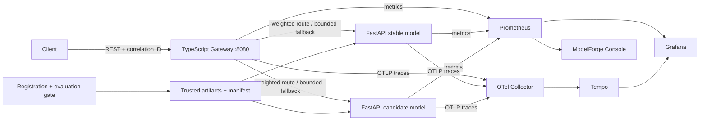

# ModelForge — ML Inference & Observability Platform

A runnable ML inference platform with versioned scikit-learn models, a TypeScript canary gateway, release validation, failure isolation, and operational telemetry. A dark observability console provides Overview, Alerts, Explorer, and per-model views backed by live metrics. Includes a local development stack and AWS deployment configuration.



## Start locally

Prerequisites: Git, **Node.js 22 or 24**, **uv 0.13.6 or newer**, and Make. `uv` installs Python 3.12. Docker Engine/Desktop with Compose v2 is required for the full telemetry stack. Initial setup needs internet access; AWS credentials are never needed locally.

```bash
git clone https://github.com/sumeetweb/modelforge.git
cd modelforge
make setup
make up
make smoke
```

Console: [localhost:8080/console/](http://localhost:8080/console/). Gateway health: [localhost:8080/health](http://localhost:8080/health). Grafana: [localhost:3000](http://localhost:3000), provisioned **ModelForge / Inference Operations** dashboard. Prometheus: [localhost:9090](http://localhost:9090). Ports bind only to loopback; model servers and tracing services stay on the Compose network. Grafana has read-only anonymous access for this local demo and no initial admin user. `make down` stops the stack; telemetry is intentionally ephemeral.

**Without Docker**, after `make setup`:

```bash
make local                      # keep this terminal running; Ctrl-C stops all three services
# In another terminal:
make smoke
make load-test USERS=20 DURATION=60s
```

Host mode uses model ports 8001/8002 and gateway port 8080. It serves the console and Prometheus metrics but does not start Grafana, Prometheus, or Tempo. Set `PROMETHEUS_URL` to a running Prometheus HTTP origin to connect the console; without it the console shows an explicit unavailable state. Do not run host and Compose modes on port 8080 simultaneously.

## API

```bash
curl -s http://127.0.0.1:8080/ready
curl -s http://127.0.0.1:8080/v1/routing
curl -i http://127.0.0.1:8080/v1/predict \
  -H 'Content-Type: application/json' \
  -H 'X-Request-ID: demo-request-1' \
  -H 'X-Routing-Key: demo-user-42' \
  -d '{"instances": [[5.1, 3.5, 1.4, 0.2]]}'
```

The four measurements are sepal length, sepal width, petal length, and petal width in centimetres. A batch contains 1–128 rows, each with four finite numbers in [0, 30]. The gateway caps request bodies at 64 KiB. Unknown fields, strings masquerading as numbers, and malformed batches are rejected.

Illustrative response (probabilities depend on the registered model):

```json
{"model_version":"v1","schema_version":"iris-v1","predictions":[{"label":"setosa","probabilities":[0.98,0.019,0.001]}]}
```

Headers include `X-Request-ID`, `X-Model-Target`, and `X-Model-Fallback`. A printable `X-Routing-Key` deterministically hashes into a traffic bucket; omit it for independent random routing. It is a demonstration control, not an authorization mechanism. The gateway returns 422 for invalid prediction input, 413 for oversized requests, and 503 for overload or complete upstream failure. Error envelopes contain `error.code`, `error.message`, and `error.request_id`; they never echo prediction inputs.

| Component | Responsibilities and endpoints |
|---|---|
| Python / FastAPI | Separate artifact loader and inference runtime; `/health`, `/ready`, `/v1/model/info`, `/v1/predict`, `/metrics` |
| TypeScript / Fastify | Request and response validation, two-target weighted routing, deadlines, retries, circuit breakers, capacity bound; `/health`, `/ready`, `/v1/routing`, `/v1/predict`, `/v1/observability`, `/metrics`, `/console/` |
| Artifact CLI | Local trusted training, SHA-256 checks, schema/library compatibility, held-out evaluation, release files and rollback history |
| Observability | Prometheus counters/histograms/alerts, Grafana dashboard, W3C trace context through OTLP Collector to Tempo, JSON logs |
| AWS CDK | Separate registry foundation and platform stacks; ECR, S3, private ECS tasks, ALB, CloudWatch, autoscaling, scoped OIDC federation |

## Observability console

Open `/console/` on the gateway. Overview shows prediction volume, throughput, response latency, server error rate, and model readiness. Alerts shows firing, pending, and inactive Prometheus rules; it sends no notifications. Explorer offers a fixed metric catalog, label filtering, and CSV export. Each model page shows inference performance, routing share, and artifact metadata. There are no account or user-management flows.

The window selector supports 15 minutes, 1 hour, 6 hours, and 24 hours. Live updates run every 15 seconds and can be paused. Rates use a rolling two-minute interval; request volume uses Prometheus `increase` and is an estimate, especially around restarts and missed scrapes. Percentiles are histogram estimates. Empty or unavailable telemetry is never replaced by sample values. Offline holdout accuracy is labeled separately from live inference performance; drift and online accuracy are not measured.

`GET /v1/observability?window=1h` is a read-only, same-origin facade. It uses a fixed query catalog, bounded time windows, response sizes and timeouts, and a 10-second shared cache per window. It exposes safe model metadata and evaluated alert states, without returning internal scrape URLs or accepting arbitrary PromQL. Keep the gateway behind the existing network boundary: this project has no authentication layer.

For frontend development, start the backend, then run `npm run dev -w @modelforge/console`. Vite proxies `/v1` to the gateway. `npm run build` builds the console before the gateway; the production gateway serves the compiled assets directly.

## Register, validate, canary, roll back

`make setup` registers v1 and v2 from sklearn's bundled Iris dataset. No dataset downloads, external model files, API keys, or research pipeline are involved. Artifact bytes are immutable per version. Manifests store checksum, feature and output contracts, sklearn version, accuracy, training metadata, and lifecycle state. `uv.lock`, the hash-pinned runtime requirements export, and `package-lock.json` fix the dependency trees.

```bash
scripts/register-model v3 --regularization 3
scripts/validate-artifact v3
scripts/promote-model v3 --weight 10
docker compose --env-file model-artifacts/routing.env up -d --force-recreate model-stable model-candidate gateway
make smoke
# Inspect errors, p95, fallback rate, and actual model distribution before increasing traffic:
scripts/promote-model v3 --weight 100
docker compose --env-file model-artifacts/routing.env up -d --force-recreate model-stable model-candidate gateway
# Restore the immediately preceding release configuration:
scripts/rollback-model
docker compose --env-file model-artifacts/routing.env up -d --force-recreate model-stable model-candidate gateway
```

In host mode, restart `make local` after each release change. The stable version remains v1 during this demo, preserving a fallback baseline. The release JSON is authoritative; manifest lifecycle state records the last validation/promotion action. At 0% weight the candidate is still eligible for emergency fallback, and at 100% the stable server is still eligible. To completely withdraw a broken artifact, point both roles to a known-good version via explicit release configuration. See [artifact lifecycle](model-artifacts/README.md) for the trust boundary, limitations, and candidate smoke gate.

## Verification and incident demos

```bash
make test                       # Python + actual-process integration + gateway + CDK tests
make lint                       # Ruff, Prettier, strict TypeScript compilation
make security                   # pip-audit and npm audit; requires internet
make synth                      # produces CloudFormation; no AWS account required
make smoke                      # checks a running stack
.venv/bin/python scripts/check-observability.py # verifies real console telemetry
.venv/bin/python scripts/check-compose.py # Docker traces, outage alert, fallback, recovery
make load-test USERS=20 DURATION=60s
scripts/simulate-incident unavailable
scripts/simulate-incident slow
scripts/simulate-incident invalid-artifact
scripts/simulate-incident rejected-candidate
scripts/simulate-incident rollback
scripts/simulate-incident errors
```

`check-compose.py` temporarily stops the Compose candidate model and restores it in a `finally` block; use it only on the local test stack with a nonzero canary weight.

Incident commands launch isolated services on ephemeral loopback ports, assert expected failures/recovery behavior, and stop the services. They do not disrupt your running demo. [Runbooks](docs/incident-runbooks.md) explain telemetry and manual recovery. [Load testing](load-tests/README.md) includes a results template and measured results when available.

## Delivery and operations

CI lints, tests, checks artifact gates and dependency vulnerabilities, synthesizes CDK, builds and smoke-tests Compose, and checks Prometheus configuration. Manual workflows independently publish application images and validated model artifacts; a deployment workflow selects existing image and model versions. AWS authentication uses GitHub OIDC, with protected staging/production environments. Failed smoke gates fail the workflow; **model rollback requires an operator**. ECS can automatically roll back an unhealthy task deployment, which is a different mechanism.

Default gateway policy: 20% candidate, 500 ms per attempt, zero retries, three failed requests to open a circuit, five-second cooldown, one half-open probe, and 128 concurrent predictions. Optional retries are capped at two. Worst-case upstream waiting is `2 × (retries + 1) × timeout`; validation and scheduler overhead add to that. Only idempotent predictions are retried. Successful fallback can hide a failed candidate, so alert on fallback and model failures alongside gateway errors. Metric labels contain only configured versions/roles, fixed reasons, normalized route templates, bounded HTTP methods, and status values. Gateway and model APIs record completion counts and response latency, including rejected inputs. Health/readiness/scrape endpoints have metrics but omit routine logs and spans.

## AWS deployment

Validate the AWS infrastructure templates with `make synth`. Provisioning, image publication, deployment, staging validation, costs, and cleanup are detailed in [deployment.md](docs/deployment.md). The CDK configuration defines an internal ALB, private ECS services, and CloudWatch logs, dashboards, and alarms. An internet-facing deployment requires a certificate and restricted client CIDR; models never receive public ingress. When deployed, a private Prometheus task discovers all gateway and model replicas through Cloud Map, and a private OpenTelemetry collector exports traces to AWS X-Ray. The same console is bundled into the gateway image. AWS Prometheus keeps up to two days / 10 GB of task-local history, which resets on task replacement.

## Project map

```text
services/console/             Vite/TypeScript observability console
services/model-server/        FastAPI runtime, artifact library, tests, Dockerfile
services/model-gateway/       TypeScript routing, telemetry, HTTP tests, Dockerfile
model-artifacts/              Manifest example, generated version registry and release history
scripts/                     Lifecycle, startup, health and incident commands
tests/integration/           Real Python/Node HTTP and failure scenarios
load-tests/                  Locust suite, distribution output, benchmark template
observability/               Prometheus alerts, Grafana dashboard, Collector and Tempo
infra/cdk/                   AWS stacks and infrastructure assertions
.github/workflows/           CI, image/model publication, deployment and smoke gates
docs/                        Architecture, decisions, runbooks and deployment
```

See the [architecture](docs/architecture.md) and [design decisions](docs/design-decisions.md) for implementation details and tradeoffs.

## Known boundaries

This small deployment has no client authentication, tenancy, durable online feature store, or business-data evaluation. Checksums detect corruption, not malicious artifacts from a compromised trusted writer: joblib can execute code. Circuit breakers are per gateway process, release files support a single operator, traffic changes require restart/redeployment, and the simple canary gate is operator-driven rather than an automated statistical controller. Cancelling an HTTP call does not guarantee that Python stops inference. Tracing exports are optional and not a delivery dependency. Add authentication, signed artifact provenance, centralized rollout state, representative evaluation data, sustained load tests, and durable highly available telemetry before treating this as a production platform.

Licensed under the [MIT License](LICENSE).
